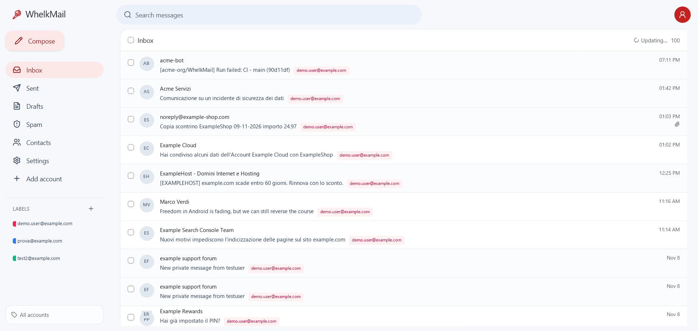
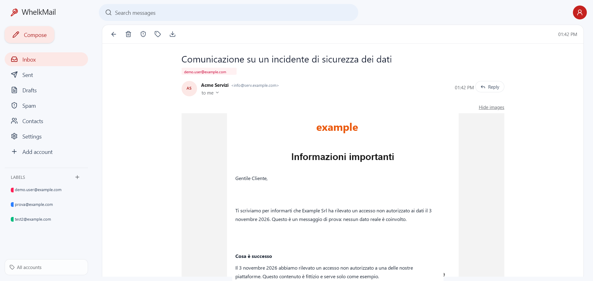
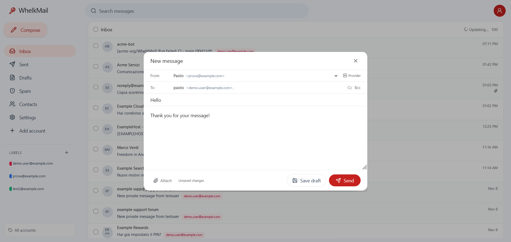
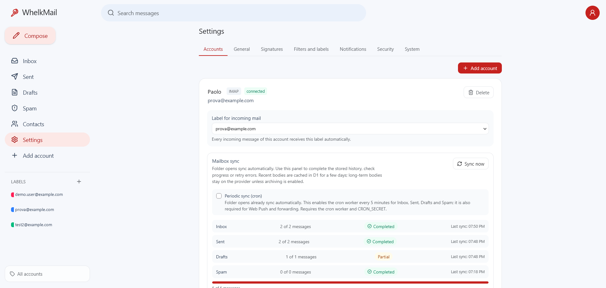
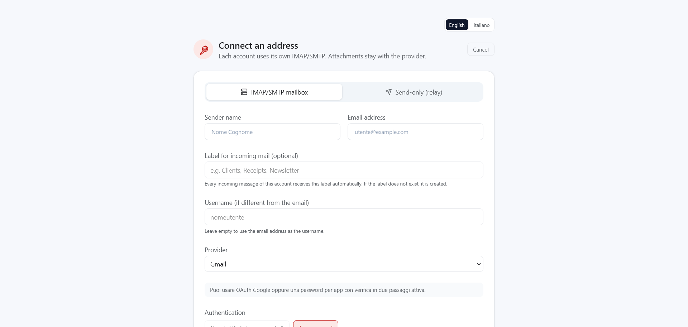

# WhelkMail

**Your mailboxes. Your domain. One calm inbox.**

[](LICENSE)
[](https://pages.cloudflare.com)
[](#using-this-repository)

WhelkMail is a self-hosted webmail client for the IMAP and SMTP accounts you already own. It runs entirely on Cloudflare Pages and Workers, so there is no mail server to operate and no infrastructure to babysit.

Connect Gmail, Outlook, iCloud, Fastmail, Yahoo or a custom domain and get a familiar, Gmail-style interface on top of the mailboxes you already use. Messages, sent copies, drafts and attachments stay on your provider; only a short-lived D1 cache and the strictly opt-in long-term archive copy them.

> **WhelkMail is not a mail server.** It talks IMAP and SMTP to the providers you already trust.

[Quick start](#quick-start) · [Deploy on Cloudflare](#deploy-on-cloudflare) · [Security](#security) · [Documentation](#documentation)

## Screenshots



| Reading a message | Composing |
| --- | --- |
|  |  |

| Account settings | Connect an address |
| --- | --- |
|  |  |

## Why WhelkMail

- **One inbox, many accounts.** Gmail, Outlook, iCloud, Yahoo and custom domains side by side, with colored account labels and a shared address book.
- **Cloudflare-native.** Pages Functions, D1, R2 and `cloudflare:sockets`: no VPS, no container, no mail server to patch.
- **Your data stays put.** By default the client reads from the provider. A short-lived D1 cache keeps recently listed or opened bodies for fast opens; the long-term archive on R2 or Google Drive remains strictly opt-in.
- **Privacy by default.** HTML email is rendered in a sandboxed frame, remote images and tracking pixels stay blocked unless you enable them for a message, and credentials are encrypted at rest.
- **Actually yours.** Self-hosted, MIT licensed, no telemetry, no vendor account required beyond your Cloudflare project.

## What you get

### Inbox experience

- Message list with a full-width reading view or an optional right-side reading pane, plus Gmail-style multi-select for delete, move and spam actions.
- Inbox, Sent, Drafts and Spam with autosave and reopenable drafts.
- HTML bodies in a sandboxed frame with optional remote images; attachment indicators from `BODYSTRUCTURE` without downloading the body up front.
- Installable PWA, mobile drawer layout and Web Push notifications with per-account/folder preferences.
- English by default, Italian available; the dictionary is extensible.

### Accounts and sending

- Multiple accounts in one view, each with its own IMAP/SMTP servers and credentials.
- Password, app-password, Google OAuth2 and Microsoft OAuth2 (XOAUTH2) authentication.
- Sending through each account's own SMTP server.
- Send-only "relay" accounts (SMTP2GO, Resend, Mailgun, Brevo, SendGrid, Mailjet, Postmark or a custom SMTP server with manual host/port/credentials) for domains without SMTP. Sent copies and drafts go to Google Drive, Cloudflare R2, or the Sent/Drafts folders of an IMAP account you already read — pick one destination per account.
- Optional archive and provider cleanup for IMAP: archive bodies and attachments, then move the original to the provider Trash.

### Organization

- Gmail-style labels shared across all accounts, with a label view that collects messages from Inbox, Sent, Drafts and Spam.
- Per-account incoming labels applied automatically.
- Contacts with search, edit, CSV import/export and recipient autocomplete in To/Cc/Bcc.
- Signatures: one shared signature or a different signature per account.

### Automation

- Gmail-style filters shared across accounts: match From/To/Subject/words/attachments and apply labels and/or forward the original EML.
- Incremental, resumable IMAP metadata sync into D1, with per-account status and automatic resume.
- Optional background sync through the cron worker every 5 minutes.
- Anti-loop forwarding headers, per-filter forward logs and deletion logs.

## Security

- Single deployment password plus optional **TOTP two-factor authentication** (RFC 6238) from Settings → Security, disabled by default and compatible with any authenticator app. Recovery codes are shown once and stored hashed.
- Random server-side sessions stored as SHA-256 hashes in D1, 7-day TTL, real revocation on logout.
- Login and 2FA rate limiting per IP.
- AES-256-GCM encryption for IMAP/SMTP passwords, OAuth refresh tokens and relay keys; HKDF-derived keys for session and challenge signatures.
- One-time OAuth state stored in D1 plus PKCE (`S256`) for Google, Microsoft and Drive.
- CSP, HSTS, `nosniff`, `X-Frame-Options`, `Referrer-Policy` and `Permissions-Policy` on static assets and API responses.
- HTML bodies rendered in a sandboxed iframe with a restrictive CSP; scripts and forms are blocked and remote images are opt-in per message.

See [docs/DOCUMENTATION.md](docs/DOCUMENTATION.md) for the full threat model and [docs/CLOUDFLARE.md](docs/CLOUDFLARE.md) for the deployment checklist.

## Stack

- React 19 + Vite 8 + TypeScript + Tailwind CSS
- Cloudflare Pages Functions (Workers runtime)
- Cloudflare D1 for accounts and metadata
- `cloudflare:sockets` for IMAP/SMTP
- Optional Cloudflare R2 or Google Drive for archive
- `postal-mime` for MIME parsing

## Quick start

Requirements: Node.js 22+ and npm.

```bash
npm install
cp wrangler.toml.example wrangler.toml
npm run db:local
```

The example uses a placeholder D1 ID; for local development that is fine. For a real deployment, create your own database and replace it (or configure the `DB` binding in the Pages dashboard).

If you already have a local database created before labels/signatures, run `npm run db:migrate:local`. If you only need the security tables (sessions, rate limiting, OAuth state), run `npm run db:migrate:local:12`; existing sessions are invalidated.

Create `.dev.vars` in the project root:

```env
APP_PASSWORD=change-me
TOKEN_ENC_KEY=<32-byte base64 key>
```

Generate the key with:

```bash
node -e "console.log(require('crypto').randomBytes(32).toString('base64'))"
```

Start the app in two terminals:

```bash
npm run dev       # Vite on http://localhost:5173
npm run dev:api   # Pages Functions on http://localhost:8788
```

Open `http://localhost:8788` and sign in with `APP_PASSWORD`.

## Using this repository

This project is meant to be self-hosted. Do not point your deployment at someone else's database or secrets:

- use **Use this template** (or a fork) to create your own copy;
- create your own D1 database and run the migrations;
- set your own secrets in the Cloudflare dashboard;
- keep `wrangler.toml` local (it is gitignored) or configure the `DB` binding in the dashboard. Start from `wrangler.toml.example`.

## Deploy on Cloudflare

The complete guide — dashboard clicks, exact commands, bindings, secrets, OAuth apps and troubleshooting — is in [docs/CLOUDFLARE.md](docs/CLOUDFLARE.md).

Short version:

1. Create the database and configure the D1 binding. For local/CLI work, copy the example and paste your own ID:
   ```bash
   cp wrangler.toml.example wrangler.toml
   npx wrangler d1 create mail-client
   ```
   The D1 database keeps the legacy `mail-client` name so existing data keeps working; the Pages project is named `whelkmail`. Do not commit `wrangler.toml`: for GitHub deployments, set the `DB` binding in the Pages dashboard instead.
2. Create a Pages project from GitHub. Build settings:
   - Build command: `npm run build`
   - Output directory: `dist`
   - Root directory: `/`
   - Environment variable: `NODE_VERSION=22`
3. Add the D1 binding `DB` and the secrets `APP_PASSWORD` and `TOKEN_ENC_KEY`.
4. Apply the schema:
   ```bash
   npm run db:remote
   ```
   If the database already existed before labels and signatures were added, run the additive migrations too:
   ```bash
   npm run db:migrate:remote
   ```
   If you only need the security tables, run `npm run db:migrate:remote:12`.
5. Optional Web Push:
   ```bash
   npm run vapid
   ```
   Add `VAPID_PUBLIC_KEY`, `VAPID_PRIVATE_KEY`, `VAPID_SUBJECT` and a random `CRON_SECRET` to the Pages project, then copy the cron worker template, set your Pages URL in it and deploy:
   ```bash
   cp worker/wrangler.toml.example worker/wrangler.toml
   # set APP_URL in worker/wrangler.toml
   npm run cron:deploy
   ```
   `worker/wrangler.toml` is gitignored and `npm run cron:deploy` refuses to deploy while `APP_URL` is still a placeholder.
6. Deploy and open the Pages URL.

A Workers Paid plan is recommended: IMAP/SMTP TLS handshakes could exceed the free plan CPU budget.

## Configuration

IMAP/SMTP accounts need no central mail configuration: each account stores its own servers and credentials.

Optional deployment settings:

| Variable | Purpose |
|---|---|
| `GOOGLE_CLIENT_ID` / `GOOGLE_CLIENT_SECRET` | Google Drive archive for relay and IMAP accounts |
| `GOOGLE_MAIL_CLIENT_ID` / `GOOGLE_MAIL_CLIENT_SECRET` | Google OAuth for IMAP/SMTP |
| `MICROSOFT_CLIENT_ID` / `MICROSOFT_CLIENT_SECRET` / `MICROSOFT_TENANT` | Outlook / Microsoft 365 OAuth |
| `RELAY_PROVIDER` / `RELAY_API_KEY` / `RELAY_API_SECRET` | Deployment-wide relay fallback |
| `MAILGUN_DOMAIN` / `MAILGUN_REGION` | Mailgun relay fallback |
| `BUCKET` (R2 binding) | Optional R2 archive |

Relay credentials can also be entered per account in the UI and are encrypted at rest.

## Documentation

- [docs/CLOUDFLARE.md](docs/CLOUDFLARE.md) — complete Cloudflare deployment and usage guide
- [docs/DOCUMENTATION.md](docs/DOCUMENTATION.md) — architecture, security, mailbox behavior and limitations
- [docs/DEVELOPMENT.md](docs/DEVELOPMENT.md) — local workflow, database migrations, tests and publishing to the public repository

## Limitations

- No IMAP IDLE: folder lists are served from the D1 mirror and a background sync refreshes new mail and flags. While a sync is in progress, the client polls the lightweight sync status with backoff and refreshes the list when new UIDs, backfill progress or the folder state change, including a final refresh when the sync finishes. Sync can also be started manually from Settings and runs every 5 minutes for accounts with automatic sync enabled (new IMAP accounts enable it by default).
- Web Push requires VAPID keys, the separate cron worker under `worker/`, and the `CRON_SECRET` secret shared by Pages and the worker.
- HTML bodies are rendered in a sandboxed frame. Remote images are blocked by default and can be enabled per message. Links open in a new tab; scripts and forms are disabled.
- The first open of an account bootstraps the newest messages from the provider; afterwards the folder list comes from D1. Sync uses UIDNEXT and bounded backfill windows instead of scanning every UID on each run. Search runs against the D1 mirror across Inbox, Sent, Drafts and Spam, with an optional per-folder scope, and also matches contacts. Matching is a case-insensitive substring test (`LIKE`), not a full-text index: no stemming and no fuzzy matching. IMAP bodies are indexed progressively (a few per sync chunk, plus every message you open), so a search matches body text only for messages that have been indexed so far; the rest still match sender, recipients and subject.
- Lists and search results are paginated with a keyset cursor (`Load more messages` at the bottom of the list) instead of one fixed 100-message cap.
- Inbox, Sent, Drafts and Spam are available as folders. Messages can be selected in bulk, deleted, moved to Inbox/Spam/Trash, or marked as spam from the reading pane.
- Recent message bodies (up to 512 KB) are cached in D1 for up to 3 days; larger messages and attachments are re-read from the provider unless a long-term archive is configured. Inline `cid:` images are embedded in the detail response.
- A label view uses the D1 mirror when available and falls back to fetching the labeled UIDs from the provider.
- Mirrored IMAP metadata is kept indefinitely by default. Settings → Appearance can limit it to a retention window: older messages are removed from the D1 mirror (never from the provider, and never drafts), together with their label assignments. Pruned messages disappear from lists, search and label views and are not re-listed by the incremental sync; only a direct message link still opens one, because the body is fetched from the provider on demand. Settings → Appearance shows the last cleanup (time and count) and **Download metadata again** clears the sync cursors so the mirror is rebuilt from the provider in the background — the messages come back, their labels do not. The archive copy in R2/Drive is left untouched.
- Filters run when the inbox is loaded and when a sync ingests new inbox messages. Matching uses From/To/Subject/snippet, not the full message body.
- Forwarding and provider deletion run from the cron worker, so they require the same setup as Web Push. They only act on new incoming messages detected after the initial sync.
- No alias-based "send as" yet: the sender is the account address.
- Switching the IMAP body archive between R2 and Drive keeps the previously archived messages readable: each row records the backend that wrote it (legacy rows fall back to trying both).
- Send-only accounts that keep sent copies and drafts in an IMAP mailbox (`storage_driver = 'imap'`) depend on that account: while it is disconnected, new drafts fail until you reconnect it or switch the relay account back to Drive/R2. When the deployment has Drive or R2 available, a failed APPEND falls back to it so the message (attachments and `.eml` included) is not lost; without object storage only the body stays readable from D1. The draft is also a real message in that mailbox, but its mirrored copy is filtered out of the Drafts list and of draft searches, so it is listed once, under the relay account.
- Single shared `APP_PASSWORD` (with optional TOTP); this is a personal / small-team tool, not a multi-tenant service.
- Login rate limiting is per IP and best-effort, not a substitute for Cloudflare Access or a WAF.
- Account deletion removes D1 rows and makes a best-effort cleanup of R2/Drive objects referenced in D1 (grouped per driver, so objects written before a destination change are found); it never deletes mail from the provider. Deleting a mailbox that stores the sent copies of a send-only account needs a second confirmation, because those copies stay on the provider but their attachments and `.eml` stop being reachable from the app.
- Provider error details are returned to the authenticated admin to help with IMAP/SMTP setup.
- Workers Paid is recommended because IMAP/SMTP TLS handshakes could exceed the free plan CPU budget.
- Google OAuth uses the restricted `https://mail.google.com/` scope. A public production app needs Google verification (CASA); personal/testing apps can use OAuth in Testing mode, where refresh tokens expire after 7 days. App passwords remain available as an alternative.

## License

MIT. See [LICENSE](LICENSE).
